# Quebrabloco

Jogo 3D de quebrar blocos, no estilo dos Brick Breakers clássicos, em que a plataforma é um veículo e a bola põe o quarteirão abaixo. Roda no navegador, no PC e no celular, sem instalar nada.

**Jogar:** https://costardiv1.github.io/quebrabloco/

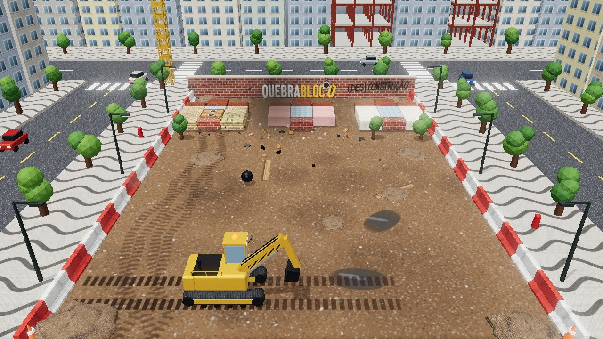

## Sobre o projeto

O Quebrabloco foi feito por Vinícius Costardi e Claude Code, em vibe code, em cerca de uma semana. O Vinícius dirigiu o jogo inteiro: as ideias, os mundos e os nomes, o jeito de cada veículo e os testes no PC e no celular. O Claude Code escreveu todo o código. Nenhuma linha foi digitada à mão.

Tudo cabe num único arquivo HTML com three.js. Os modelos 3D, as texturas, os efeitos sonoros e as músicas são gerados por código. As únicas coisas de fora são os ícones dos power-ups (desenhos vetoriais), a fonte do grafite e trechos curtos de gravações de motores e sirenes, todos embutidos no próprio arquivo.

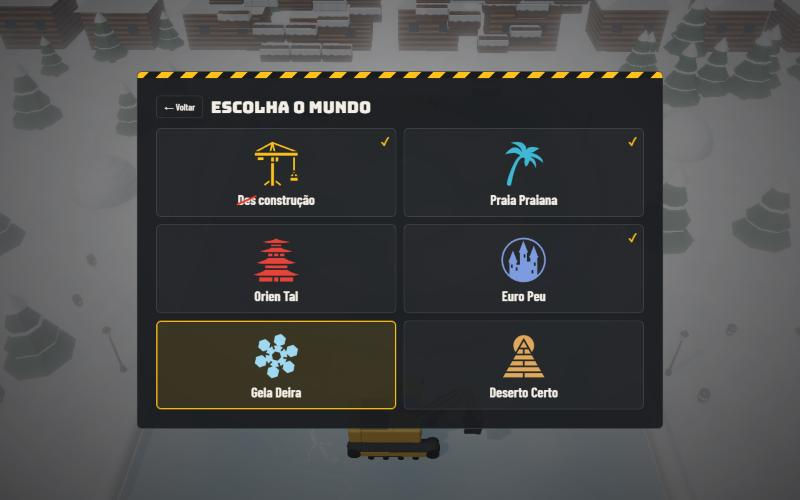

## Como jogar

O menu tem três botões: **Jogar** (escolha o mundo e depois o veículo), **Placar** (recordes de cada dificuldade e do Modo Caos, mundos vencidos, veículos e moedas) e **Opções**. Na escolha do veículo, a **Troca automática** coloca um veículo diferente, entre os que você já liberou, a cada fase.

Mexa o veículo, lance a bola e rebata para ela não passar. Quanto mais perto da ponta do veículo a bola bate, mais inclinada ela sai, e um arco translúcido mostra a direção do rebote. A bola quebra os blocos e volta; quebre todos para passar de fase. Na primeira partida, uma fase tutorial antes da fase 1 para o jogo a cada dica e só continua quando você toca em Avançar. Dá para jogar o tutorial de novo e rever as regras em Opções → Como jogar?

| | PC | Celular |
|---|---|---|
| Mexer o veículo | mouse ou setas ← → (A e D) | arrastar o dedo |
| Lançar a bola e atirar | clique ou Espaço | tocar na tela |
| Pausar | P ou Esc | botão de pausa |
| Câmera, gráficos, música e som | C, Q, N e M | botões na barra de baixo |

## Mundos

Cada mundo tem 5 fases, um chefão no fim e uma bola própria: bola de demolição, bola de praia, Temari, bola de futebol, bola de neve (que solta flocos) e escaravelho dourado. Vencer o chefão libera o próximo mundo e, do Mundo 1 ao 5, dá um veículo novo de prêmio.

| | |
|---|---|
|  **(Des)Construção** · canteiro de obras na cidade | 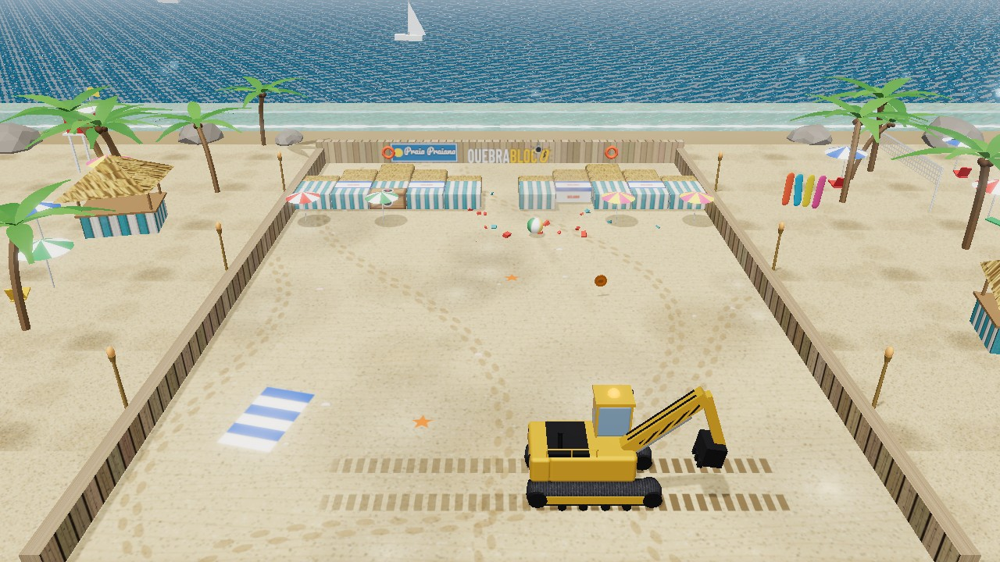 **Praia Praiana** · quiosques, guarda-sóis e o mar |
| 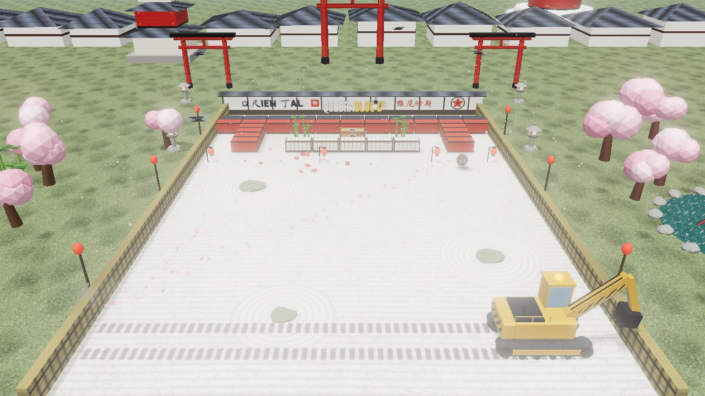 **Orien Tal** · jardim zen, cerejeiras, drones e montanhas | 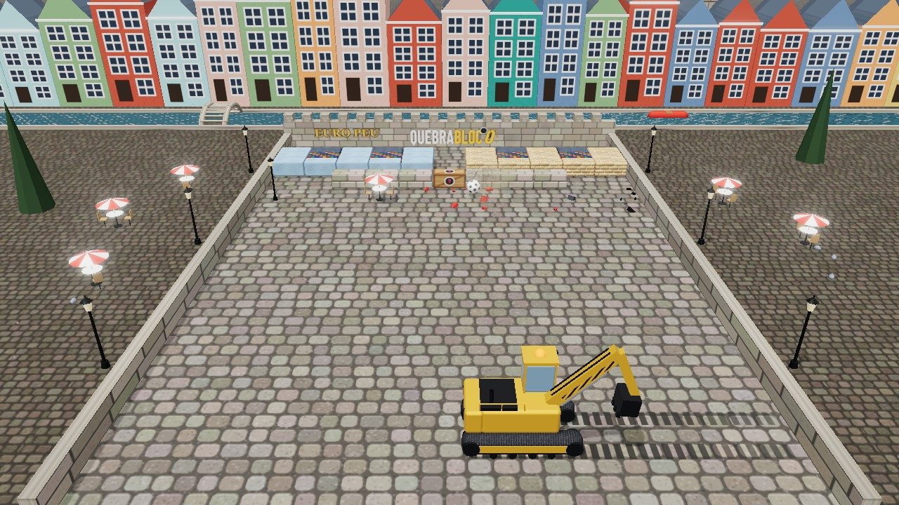 **Euro Peu** · casas de enxaimel, castelo e chafariz |
| 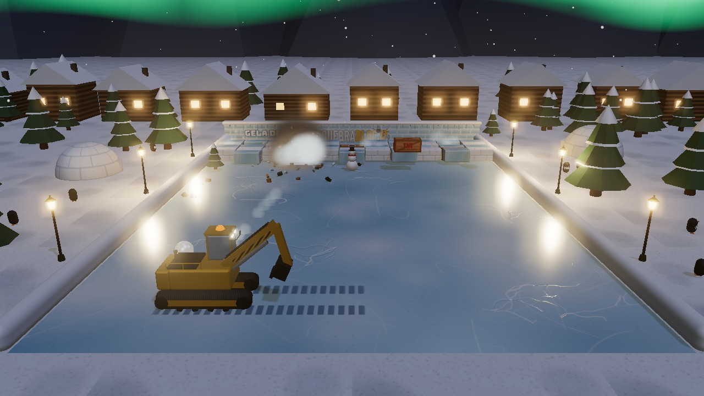 **Gela Deira** · lago congelado, iglus, pinguins e aurora boreal; o veículo escorrega no gelo | 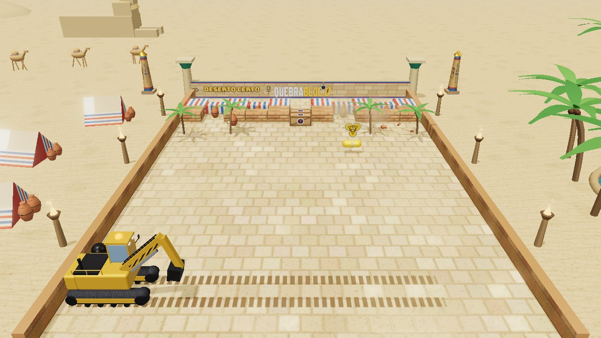 **Deserto Certo** · pirâmides, oásis e camelos; tempestades de areia escondem os blocos |

## Chefões

Só o ponto fraco tira vida; o resto do corpo é blindado e rebate a bola. Com 2/3 e com 1/3 da vida eles ficam mais bravos, e tudo o que jogam no veículo traz um debuff. Nas fases de chefão, Laser, Foguetes, Raio em Cadeia e Bola Bomba caem com mais frequência.

| | |
|---|---|
| 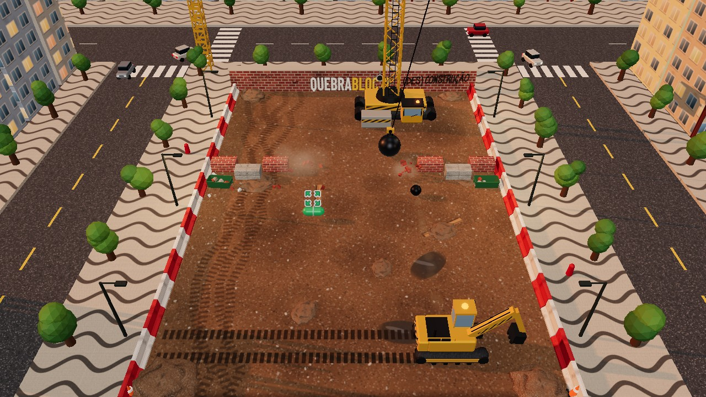 **Grua Monstra** · ponto fraco: a cabine | 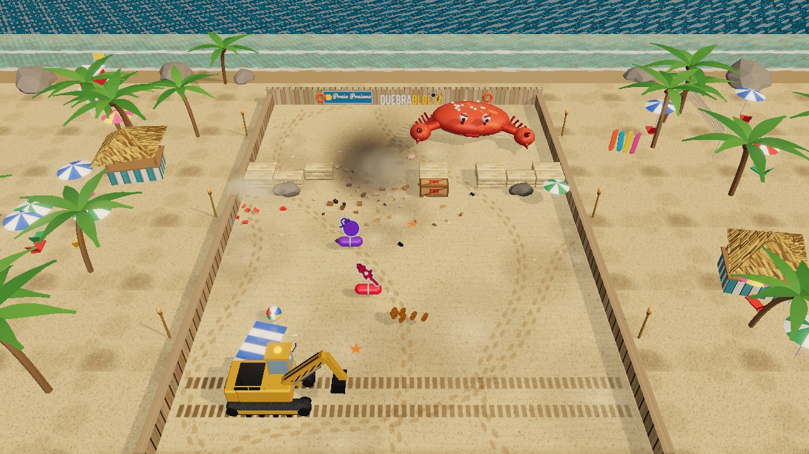 **Caranguejão** · ponto fraco: os olhos |
| 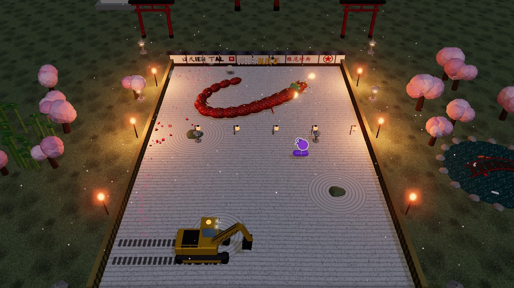 **Dragão Serpente** · ponto fraco: a cabeça | 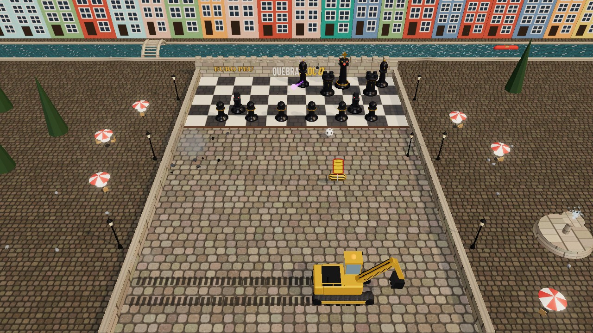 **Rei do Xadrez** · ponto fraco: o rei |
| 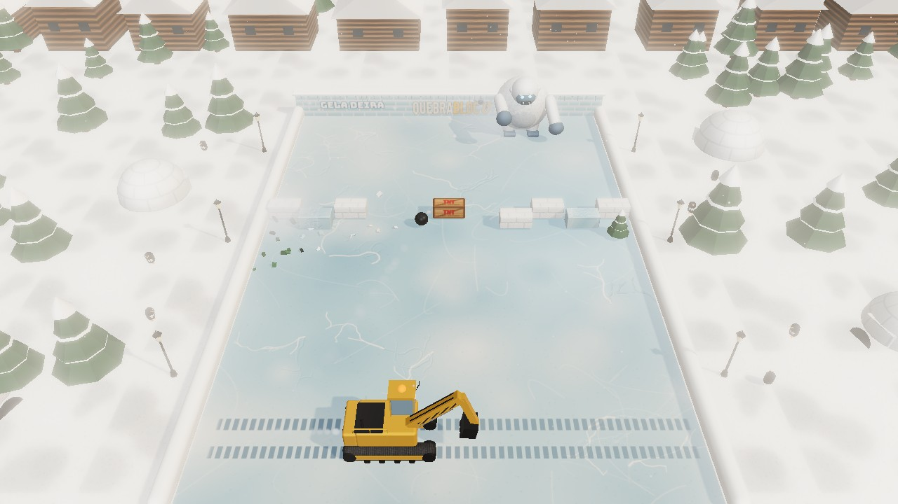 **Iéti Abominável** · ponto fraco: a cabeça, protegida pelos punhos | 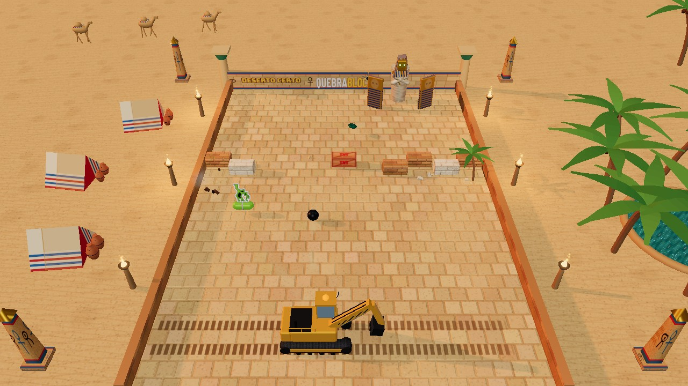 **Múmia Faraó** · ponto fraco: a máscara de ouro, entre as tampas do sarcófago |

## Veículos

São 14 veículos, cada um com seu som de motor, gravado de verdade. A viatura, os bombeiros e a ambulância ligam a sirene quando a bola volta depois de muito tempo sem bater neles.

- **De fábrica:** Escavadeira e Caminhão Caçamba
- **Prêmios dos chefões:** cada chefão dá o veículo do próximo mundo: Buggy Baja (Mundo 1), Hatch 86 (Mundo 2), Superesportivo (Mundo 3), Trator Limpa-Neve (Mundo 4) e Caminhão Rali Dakar (Mundo 5). O chefão do Mundo 6 vai dar o veículo do Mundo 7, quando ele chegar
- **Prêmios de fase:** Caminhão Betoneira (fase 2 do Mundo 1) e Viatura (fase 3 do Mundo 2)
- **Prêmios do Modo Caos:** Carro Tunado (rodada 5) e Moto Estradeira, com motoqueiro de jaqueta preta e capacete (Modo Caos completo)
- **Na garagem, com moedas:** Caminhão de Bombeiros (250), Ambulância (300) e Fórmula 1 (350)

As moedas caem de caixotes e de alguns blocos, e cada fase vencida dá mais. O Modo Caos não dá moedas.

## Power-ups e debuffs

As cápsulas caem dos caixotes de madeira e dos blocos. Os power-ups têm contorno branco; os debuffs, contorno vermelho, e é melhor desviar deles. Eles caem mais no começo de cada fase e ficam mais raros perto do fim.

- **Power-ups:** Laser, Foguetes, Ímã, Multibola, Expandir (acumula até 4 vezes), Bola de Fogo, Bola Bomba, Raio em Cadeia, Tempestade, Mega Bola, Câmera Lenta, Escudo e Vida Extra
- **Debuffs:** Encolher (acumula até 4 vezes), Turbo, Invertido, Poeirão, Óleo na Pista, Ventania, Congelado (o veículo fica preso num bloco de gelo por 1 segundo), Minibola (a bola fica pequenininha) e Bola Fantasma (a bola some perto dos blocos)

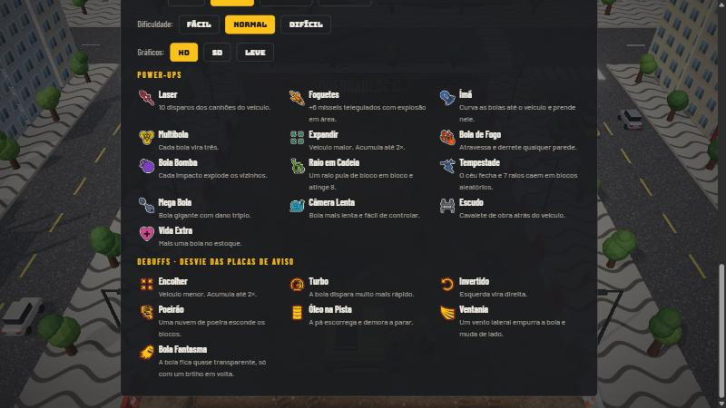

## Modo Caos

Liberado depois de vencer o chefão do Mundo 2. Uma rodada em cada um dos 6 mundos, em ordem sorteada, com chefão, chuva de power-ups e debuffs, caixotes e TNT caindo do céu e blocos que andam de um lado para o outro. Você tem 5 vidas para chegar ao fim. Ali não caem moedas, só power-ups e debuffs. Completar a rodada 5 dá o Carro Tunado, e completar o Modo Caos dá a Moto Estradeira.

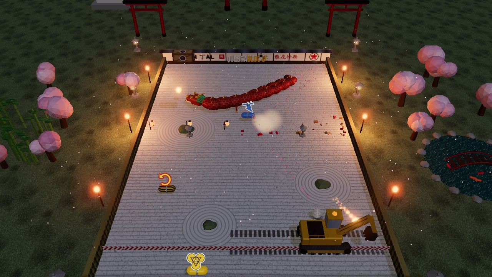

## Opções

- **Dificuldade:** Fácil, Normal ou Difícil, com um recorde para cada uma. Muda a velocidade da bola e a chance de power-ups (mais no Fácil, menos no Difícil)
- **Câmera:** alta, média, deitada ou rasante, ajustadas para PC e celular
- **Gráficos:** HD, SD ou Leve, que se ajustam sozinhos em aparelhos mais fracos
- **Resetar progresso:** apaga mundos, recordes, moedas e veículos, mantendo as configurações
- **Pausa:** congela tudo, inclusive o som, e dá para trocar câmera, gráficos, música e som com o jogo parado

## Arquivos

- `index.html`: o jogo inteiro (HTML, CSS e JavaScript), versão pública.
- `imagens/`: as fotos desta página, tiradas do próprio jogo.
- `scripts/gerar_index.py`: gera o `index.html` a partir da versão de desenvolvimento, que fica só no computador do autor.
- `chefoes.md`: o desenho original dos chefões.

## Créditos

Feito por Vinícius Costardi e Claude Code. Desenvolvido em vibe code.

- three.js r170 (licença MIT)
- Sons de motores e sirenes: [BigSoundBank](https://bigsoundbank.com) (Joseph Sardin), CC0
- Ícones dos power-ups e debuffs: [game-icons.net](https://game-icons.net) (Lorc, Delapouite e colaboradores), licença CC BY 3.0
- Fontes do Google Fonts (SIL Open Font License 1.1): Bungee, Barlow, Barlow Condensed, Sedgwick Ave, Pacifico, Potta One e Ma Shan Zheng
