# Quebrabloco

Jogo 3D de quebrar blocos, no estilo dos Brick Breakers clássicos, em que a plataforma é um veículo e a bola põe o quarteirão abaixo. Roda no navegador, no PC e no celular, sem instalar nada.

**Jogar:** https://costardiv1.github.io/quebrabloco/

## Sobre o projeto

O Quebrabloco foi feito por Vinícius Costardi e Claude Code, em vibe code, em cerca de uma semana. O Vinícius dirigiu o jogo inteiro: as ideias, os mundos e os nomes, o jeito de cada veículo e os testes no PC e no celular. O Claude Code escreveu todo o código. Nenhuma linha foi digitada à mão.

Tudo cabe num único arquivo HTML com three.js. Os modelos 3D, as texturas, os efeitos sonoros e as músicas são gerados por código. As únicas coisas de fora são os ícones dos power-ups (desenhos vetoriais), a fonte do grafite e trechos curtos de gravações de motores e sirenes, todos embutidos no próprio arquivo.

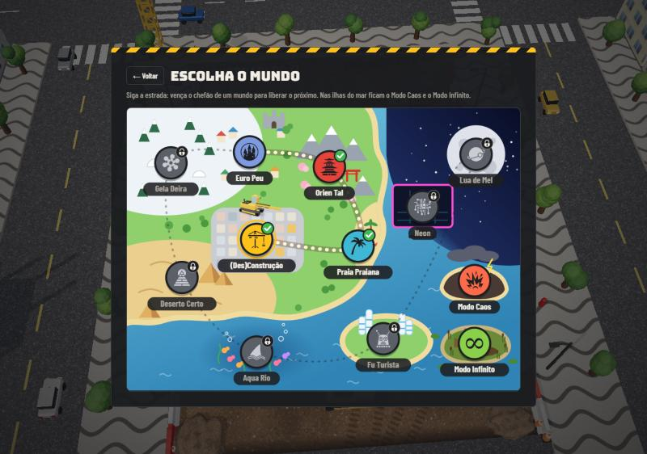

## Como jogar

O menu tem três botões: **Jogar**, **Placar** (recordes de cada dificuldade, do Modo Caos e do Modo Infinito, mundos vencidos, veículos e moedas) e **Opções**. Jogar abre o mapa: uma estrada passa pelos 10 mundos, e vencer o chefão de um mundo libera o próximo. Nas ilhas do mar ficam o Modo Caos e o Modo Infinito. Depois do mapa vem a escolha do veículo, onde o botão **Aleatório** coloca um veículo diferente, entre os que você já liberou, a cada fase. O botão Demolir! fica sempre embaixo da tela, sem precisar rolar a lista.

Mexa o veículo, lance a bola e rebata para ela não passar. Quanto mais perto da ponta do veículo a bola bate, mais inclinada ela sai, e um arco translúcido mostra a direção do rebote. A bola quebra os blocos e volta; quebre todos para passar de fase. Se você perder, "Jogar de novo" recomeça na fase em que parou, com 3 vidas e a pontuação zerada (o recorde fica salvo). Na primeira partida, uma fase tutorial antes da fase 1 para o jogo a cada dica e só continua quando você toca em Avançar. Dá para jogar o tutorial de novo e rever as regras em Opções → Como jogar?

| | PC | Celular |
|---|---|---|
| Mexer o veículo | mouse ou setas ← → (A e D) | arrastar o dedo |
| Lançar a bola e atirar | clique ou Espaço | tocar na tela |
| Pausar | P ou Esc | botão de pausa |
| Câmera, gráficos, música e som | C, Q, N e M | botões na barra de baixo |

## Mundos

São 10 mundos. Cada um tem 5 fases, um chefão no fim e uma bola própria: bola de demolição, bola de praia, Temari, bola de futebol, bola de neve (que solta flocos), escaravelho dourado, baiacu (que incha quando bate no veículo), esfera de plasma, mini Saturno e disco de luz. Vencer o chefão libera o próximo mundo e dá um veículo novo de prêmio. Vencer o chefão do Neon fecha o jogo.

| | |
|---|---|
|  **(Des)Construção** · canteiro de obras na cidade |  **Praia Praiana** · quiosques e o mar; guarda-sóis no meio da arena rebatem a bola como num pinball |
|  **Orien Tal** · jardim zen, cerejeiras, drones e montanhas; o gongo do templo solta uma onda de choque que racha os blocos por perto |  **Euro Peu** · casas de enxaimel, castelo e chafariz; um bondinho atravessa a arena e funciona como uma parede que anda |
|  **Gela Deira** · lago congelado, iglus, pinguins e aurora boreal; o veículo escorrega no gelo |  **Deserto Certo** · pirâmides, oásis e camelos; tempestades de areia escondem os blocos |
| 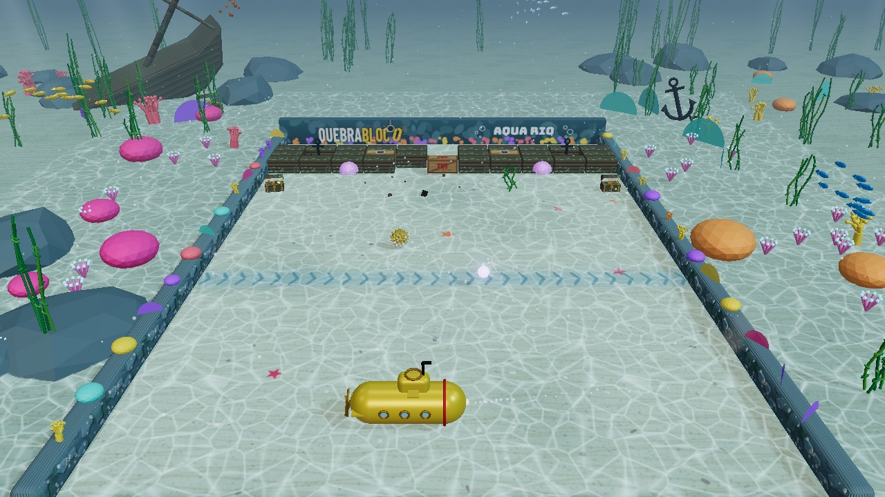 **Aqua Rio** · fundo do mar com corais, naufrágio, cardumes e arraia; correntezas empurram a bola, baús soltam moedas e águas-vivas dão choque | 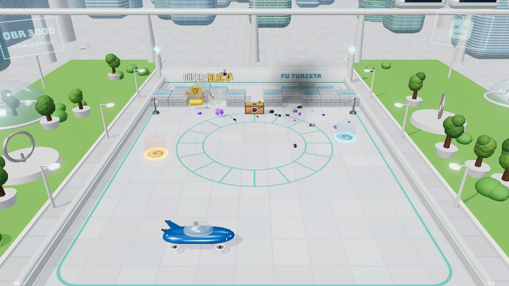 **Fu Turista** · cidade do futuro com torres de vidro, jardins, trem maglev e carros voadores, ao som de um city-pop ensolarado; portais teletransportam a bola |
| 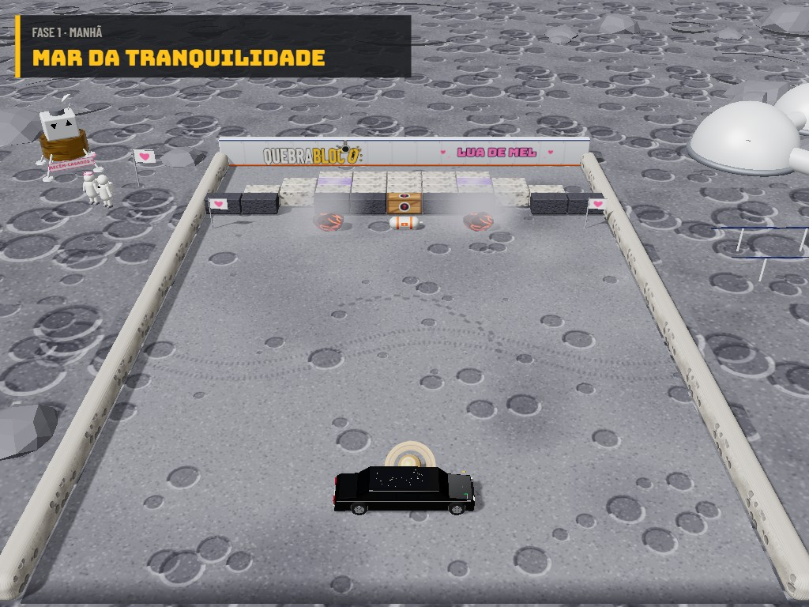 **Lua de Mel** · crateras, a Terra no céu, base lunar e o módulo dos recém-casados; a bola faz curvas com a gravidade baixa e meteoros caem na arena | 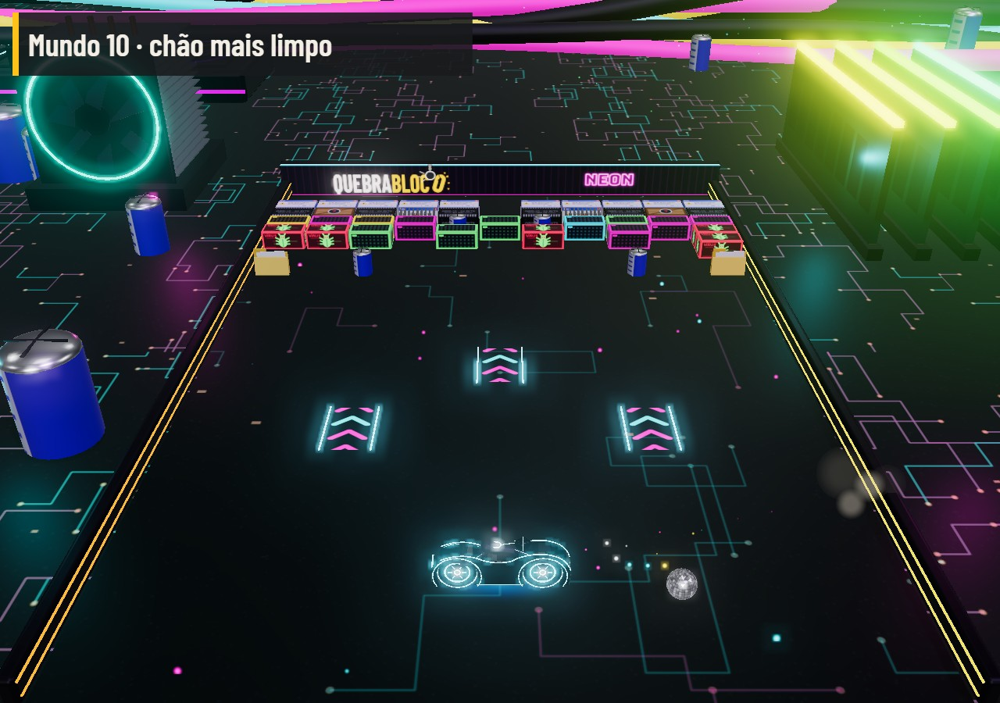 **Neon** · dentro de um computador, com placa-mãe, memórias e cooler, e o Quebrabloco rodando na tela ao fundo; tudo pulsa no ritmo de uma synthwave, vírus se copiam para os espaços vazios e setas turbo no chão aceleram a bola |

## Chefões

Só o ponto fraco tira vida; o resto do corpo é blindado e rebate a bola. Com 2/3 e com 1/3 da vida eles ficam mais bravos, e tudo o que jogam no veículo traz um debuff. Nas fases de chefão, Laser, Foguetes, Raio em Cadeia e Bola Bomba caem com mais frequência.

| | |
|---|---|
|  **Grua Monstra** · ponto fraco: a cabine |  **Caranguejão** · ponto fraco: os olhos |
|  **Dragão Serpente** · ponto fraco: a cabeça |  **Rei do Xadrez** · ponto fraco: o rei |
|  **Iéti Abominável** · ponto fraco: a cabeça, protegida pelos punhos |  **Múmia Faraó** · ponto fraco: a máscara de ouro, entre as tampas do sarcófago |
| 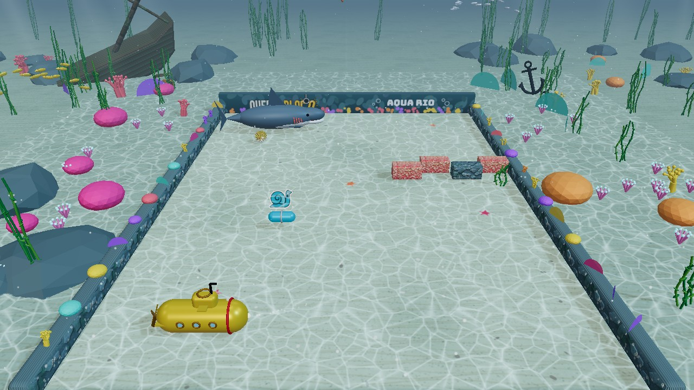 **Tubarão** · ponto fraco: as guelras; a cauda rebate a bola e a boca abocanha e cospe de volta | 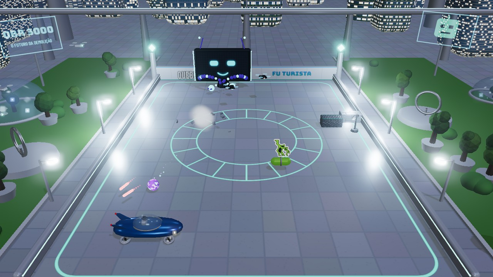 **IA Suprema** · ponto fraco: a tela; dois tentáculos de cabo varrem a arena e drones atiram laser |
| 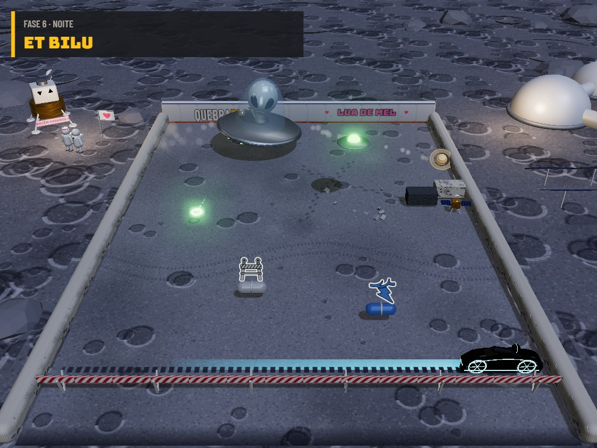 **ET Bilu** · ponto fraco: a cabeça, dentro da cúpula; mini discos voadores abduzem a bola e chovem meteoros | 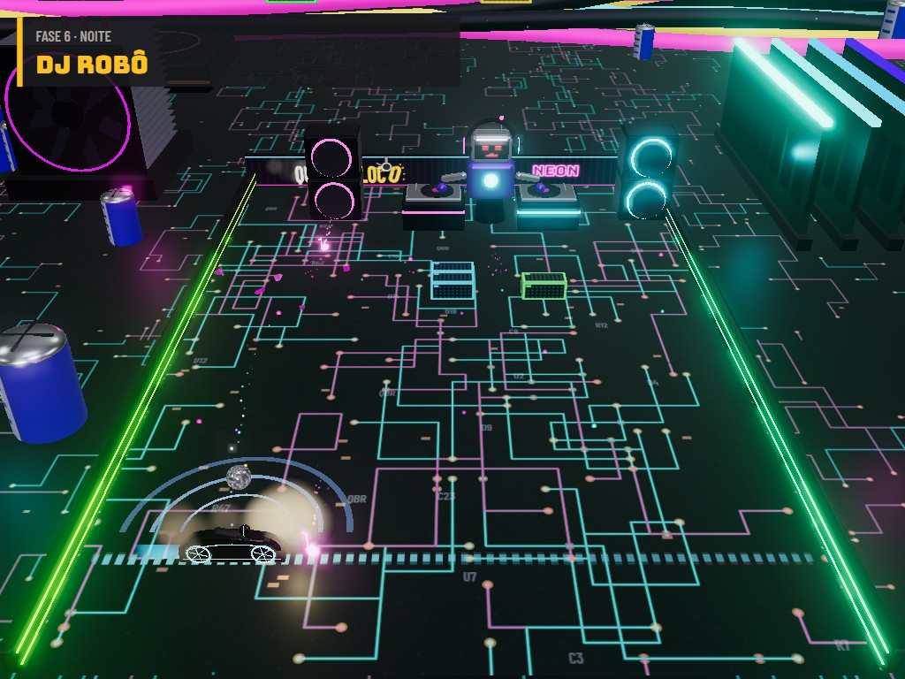 **DJ Robô** · ponto fraco: o robô; os toca-discos rebatem a bola, e ele joga notas, discos e o bass drop |

## Veículos

São 33 veículos, cada um com seu som de motor. A viatura, os bombeiros e a ambulância ligam a sirene quando a bola volta depois de muito tempo sem bater neles. Na garagem, cada veículo mostra embaixo do nome como ele é liberado.

- **De fábrica:** Escavadeira e Caminhão Caçamba
- **Prêmios dos chefões:** cada chefão dá o veículo do próximo mundo: Buggy Baja (Mundo 1), Hatch 86 (Mundo 2), Superesportivo (Mundo 3), Trator Limpa-Neve (Mundo 4), Caminhão Rali Dakar (Mundo 5), Submarino Amarelo (Mundo 6), Carro Voador, que flutua sobre quatro hélices (Mundo 7), Jipe Lunar com astronauta (Mundo 8) e Moto de Luz, com rodas de neon e uma parede de luz por onde passa (Mundo 9). O chefão final, no Mundo 10, dá a Escavadeira Dourada
- **Prêmios de fase:** Caminhão Betoneira (fase 2 do Mundo 1) e Viatura (fase 3 do Mundo 2)
- **Prêmios do Modo Caos:** Carro Tunado (rodada 5) e Moto Estradeira, com motoqueiro de jaqueta preta e capacete (Modo Caos completo)
- **Na garagem, com moedas:** Caminhão de Bombeiros (250), Ambulância (300), Fórmula 1 (350), Moto Esportiva (400), Kart (450), Moto de Trilha (500), Tuk-tuk (550), Rolo Compressor (600), Monster Truck (650), Ônibus Escolar (700), Food Truck de Sorvete (750), Caminhão de Lixo (800), Perua Hippie (850), Muscle Car (900), Limusine (950), Capivara (1000) e Tanque de Brinquedo (1050)

| | |
|---|---|
| 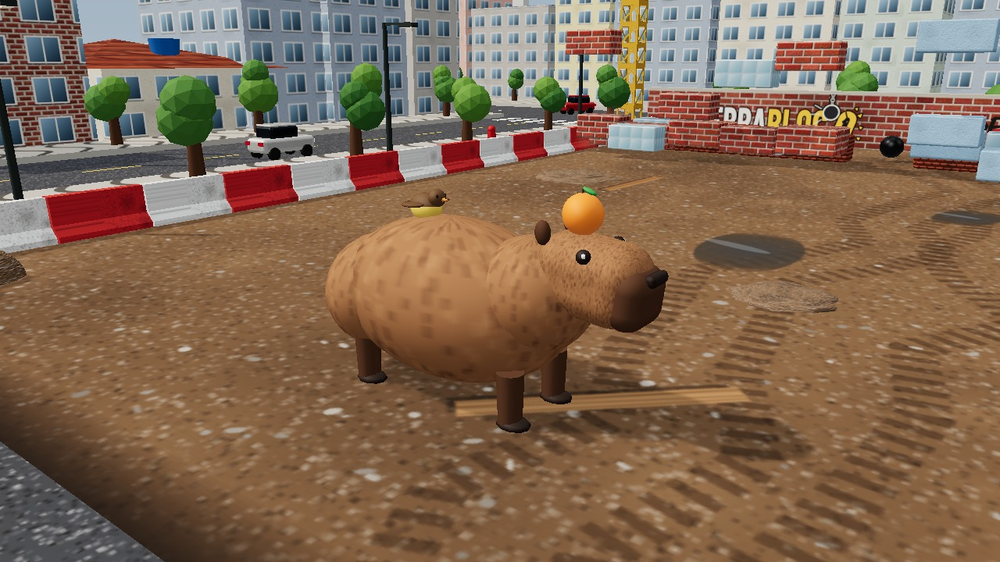 **Capivara** · com a laranja na cabeça e um passarinho nas costas; no Aqua Rio ela nada | 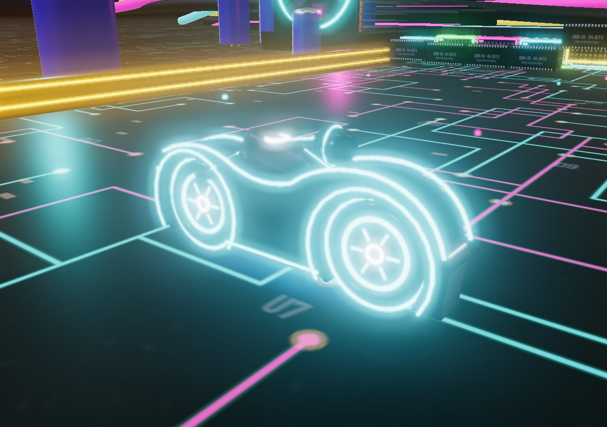 **Moto de Luz** · prêmio do chefão da Lua de Mel |

As moedas caem de caixotes e de alguns blocos, e cada fase vencida dá mais. O Modo Caos e o Modo Infinito não dão moedas.

## Power-ups e debuffs

As cápsulas caem dos caixotes de madeira e dos blocos. Os power-ups têm contorno branco; os debuffs, contorno vermelho, e é melhor desviar deles. Eles caem mais no começo de cada fase e ficam mais raros perto do fim. Um power-up que acabou de cair fica mais raro por um tempo, para variar; o Expandir é a exceção e às vezes cai em dupla.

- **Power-ups:** Laser, Foguetes, Ímã, Multibola, Expandir (acumula até 4 vezes), Bola de Fogo, Bola Bomba, Raio em Cadeia, Tempestade, Mega Bola, Câmera Lenta, Escudo e Vida Extra
- **Debuffs:** Encolher (acumula até 4 vezes), Turbo, Invertido, Poeirão, Óleo na Pista, Ventania, Congelado (o veículo fica preso num bloco de gelo por 1 segundo), Minibola (a bola fica pequenininha) e Bola Fantasma (a bola some perto dos blocos)

## Modo Caos

Fica na ilha do vulcão, no mapa, e libera depois de vencer o chefão do Mundo 1. Tem uma rodada para cada mundo que você já venceu, em ordem sorteada, sempre no chefão, com chuva de power-ups e debuffs, caixotes e TNT caindo do céu e blocos que andam de um lado para o outro. Você tem 5 vidas para chegar ao fim. Ali não caem moedas, só power-ups e debuffs. Vencer 5 chefões no Modo Caos dá o Carro Tunado, e completar o Modo Caos com os 10 mundos dá a Moto Estradeira.

## Modo Infinito

Fica na ilha do pântano, no mapa, e libera depois de vencer o chefão do Mundo 3. É uma fase só, no Pântano do Ogro, com a casa no tronco e o ogro tomando banho de lama ao fundo. Os blocos não param de cair, de vez em quando cai um power-up ou debuff e tudo vai ficando mais rápido. As vidas não acabam, mas perder a bola zera a pontuação, então só faz recorde alto quem não erra. Cada minuto sem errar dá um bônus. A bola é uma cebola.

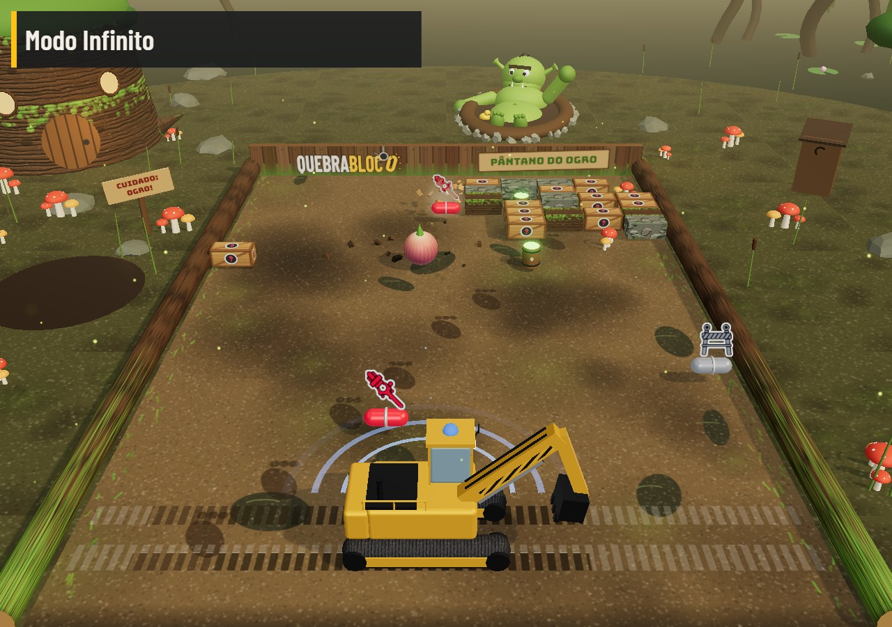

## Opções

- **Dificuldade:** Fácil, Normal ou Difícil, com um recorde para cada uma. Muda a velocidade da bola e a chance de power-ups (mais no Fácil, menos no Difícil)
- **Câmera:** alta, média, deitada ou rasante, ajustadas para PC e celular
- **Gráficos:** HD, SD ou Leve, que se ajustam sozinhos em aparelhos mais fracos
- **Resetar progresso:** apaga mundos, recordes, moedas e veículos, mantendo as configurações
- **Pausa:** congela tudo, inclusive o som, e dá para trocar câmera, gráficos, música e som com o jogo parado

## Arquivos

- `index.html`: o jogo inteiro (HTML, CSS e JavaScript), versão pública.
- `imagens/`: as fotos desta página, tiradas do próprio jogo.
- `scripts/gerar_index.py`: gera o `index.html` a partir da versão de desenvolvimento, que fica só no computador do autor.
- `chefoes.md`: o desenho original dos chefões.

## Créditos

Feito por Vinícius Costardi e Claude Code. Desenvolvido em vibe code.

- three.js r170 (licença MIT)
- Sons de motores e sirenes: [BigSoundBank](https://bigsoundbank.com) (Joseph Sardin), CC0
- Ícones dos power-ups e debuffs: [game-icons.net](https://game-icons.net) (Lorc, Delapouite e colaboradores), licença CC BY 3.0
- Fontes do Google Fonts (SIL Open Font License 1.1): Bungee, Barlow, Barlow Condensed, Sedgwick Ave, Pacifico, Potta One e Ma Shan Zheng
